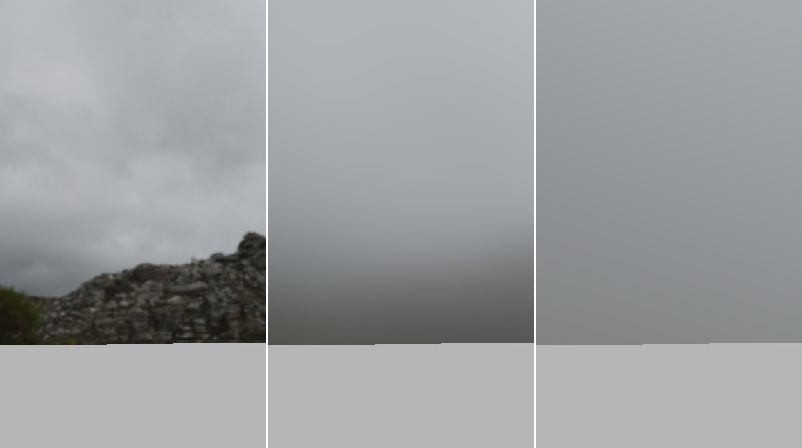
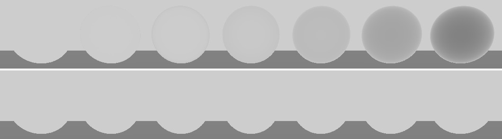

# Image based lighting

How the environment lights the scene: the HDR environment map, the
irradiance map for diffuse light, the split sum for reflections, and the
corrections on top of it.

Code: `src/rendering/EnvironmentMap.*`, the compute shaders in
`res/shaders/ibl/`, and `environmentLight` in `forward_shader.frag`.

## 1. Light from everywhere

The sun, point and spot lights come from a single direction each, and the
shader evaluates the BRDF once per light. Outside, most of the light does
not come from the sun but from the whole sky, plus what the ground and the
surroundings send back. That light was a flat hemisphere ambient before.

Image based lighting takes it from a picture of the surroundings, the
**environment map**, and integrates it over the hemisphere above each point:

```
outgoing = ∫ environment(l) * BRDF(l, v) * cos(n, l) dl
```

Doing that for every pixel would take hundreds of texture reads. Instead the
integral is split into parts that do not depend on the pixel, computed once
at startup by compute shaders, and read back with 3 texture lookups.

It replaces the ambient term, and adds what the ambient could not do:
reflections. A smooth metal now mirrors the sky.

## 2. The environment map

The source is an equirectangular HDR panorama (`.hdr`), the format of most
free HDRIs. HDR matters: the sky is many times brighter than a white wall,
and an 8-bit image would flatten that range, giving dull reflections.

At startup:

1. stb_image decodes the panorama to floats.
2. `panorama_to_cubemap.comp` resamples it into a cube map of 16-bit floats.
   Each face gets a quarter of the panorama width (512 for a 2k file), which
   keeps its resolution around the horizon.
3. Mipmaps are generated, the prefiltering reads them.

A directory of six `.jpg` faces still works, as an 8-bit environment.
`GL_TEXTURE_CUBE_MAP_SEAMLESS` is enabled so that the blurry mip levels
filter across face edges instead of showing seams.


<p align="center"><sub>The environment, the prefiltered map at roughness 0.3, and the irradiance map, shown as the sky from the debug panel</sub></p>

## 3. Diffuse: the irradiance map

A Lambert surface reflects the same light in every direction, so its
lighting only depends on its normal. For each normal direction,
`irradiance.comp` sums the environment over the hemisphere around it,
weighted by the cosine, and divides by PI:

```
irradiance(n) = 1/PI * ∫ environment(l) * max(dot(n, l), 0) dl
```

The stored value is what a white surface facing `n` sends back, the shader
only multiplies it by the diffuse color.

The result is so smooth that 32x32 faces are enough, and the sum can run
over every texel of the 32x32 mip level of the environment, each weighted by
the solid angle it covers. That is about 6000 reads per output texel, done
once, and unlike random sampling it has no noise.

## 4. Specular: the split sum

The specular integral depends on the normal, the view direction and the
roughness: too many dimensions to store. The split sum approximation
(Karis 2013, "Real Shading in Unreal Engine 4") cuts it in two factors that
are each precomputed:

```
∫ environment * BRDF * cos  ≈  prefiltered(r, roughness) * (f0 * scale + bias)
                               └── prefiltered map ───┘   └── lookup table ──┘
```

### Prefiltered map

The environment blurred by the GGX lobe, one mip level per roughness: level
0 is a mirror, the last one (8x8 faces) is roughness 1. The shader reads it
in the reflection direction, at the level of its roughness:

```glsl
vec3 radiance = textureLod(uPrefilteredMap, reflect(-v, n), roughness * lastLevel).rgb;
```

The lobe depends on the view direction, which is unknown at that point, so
`prefilter.comp` assumes the view is along the normal. The cost is that
reflections no longer stretch at grazing angles, the main visible error of
the method.

Each texel averages 256 directions drawn from the GGX distribution
(importance sampling, on a Hammersley sequence). With so few samples a small
bright spot of the environment would leave speckles, so each sample reads a
mip level of the environment as large as the solid angle it stands for
(filtered importance sampling, Křivánek and Colbert 2008).

### Lookup table

The second factor is the integral of the BRDF alone, under a uniform white
light. Fresnel is split out so that `f0` can be applied later, which leaves
two numbers, a scale and a bias, for each `NdotV` and roughness:

| | |
|---|---|
| U axis | `NdotV`, 0 to 1 |
| V axis | roughness, 0 to 1 |
| R | scale of `f0` |
| G | bias |

It depends on nothing but the BRDF: not the environment, not the material.
`brdf_lut.comp` computes it once, 128x128 texels with 512 samples each.

## 5. Multiple scattering

The microfacet BRDF only counts light that bounces once off the surface. On
a rough surface, part of the light hits another microfacet before leaving
and is simply lost: up to 40% for a rough metal. The white furnace test
shows it: white spheres in a uniform grey environment should disappear, but
the rough ones come out darker.


<p align="center"><sub>White metal spheres, roughness 0 to 1, in a uniform environment. Top: single scattering. Bottom: with the compensation.</sub></p>

The fix comes from the same lookup table (Fdez-Agüera 2019, "A
Multiple-Scattering Microfacet Model for Real-Time Image-based Lighting").
For a white surface, `scale + bias` is the energy reflected in one bounce,
`Ess`. The rest, `1 - Ess`, leaves after more bounces, each keeping the
average Fresnel reflectance. That geometric series gives the missing light,
added as a uniform lobe lit by the irradiance:

```glsl
vec3 FssEss = f0 * scale + bias;                       // single scattering
float Ems = 1.0 - (scale + bias);
vec3 Favg = f0 + (1.0 - f0) / 21.0;
vec3 FmsEms = Ems * FssEss * Favg / (1.0 - Ems * Favg); // multiple scattering
vec3 diffuse = diffuseColor * (1.0 - FssEss - FmsEms);
color = FssEss * radiance + (FmsEms + diffuse) * irradiance;
```

Direct lights lose the same energy. Their specular lobe is scaled by
`1 + f0 * (1 / Ess - 1)`, the approximation Filament uses.

## 6. Occlusion

The occlusion map darkens the diffuse part: it tells how much of the
hemisphere is hidden by the surface itself. A reflection only looks in a
cone, narrow on smooth surfaces, which is less likely to be hidden when seen
face-on. The specular part uses an occlusion derived from it, the view angle
and the roughness (Lagarde and de Rousiers 2014, "Moving Frostbite to PBR").

Normal maps can also bend the reflection direction below the real surface,
where it would read the environment through the object. It fades out there.

## 7. With the other lights

The result is added to the direct lights, never replaces them:

```
color = environment (diffuse + specular) + Σ lights (BRDF * radiance * shadow) + emissive
```

- **The sun.** A panorama with a visible sun already contains it, and the
  directional light adds a second one. The default panorama is overcast
  for that reason. With a sunny one, the analytical sun should be aligned
  with the sun of the image.
- **Intensity.** HDR files have no absolute scale. The panel scales the
  environment, and the sky drawn behind the scene with it, so reflections
  always match what the camera sees.

## 8. Costs

| | Size | Memory |
|---|---|---|
| Environment | 512x512 faces, full mip chain | 17 MB |
| Prefiltered map | 256x256 faces, 6 levels | 4 MB |
| Irradiance map | 32x32 faces | 48 KB |
| Lookup table | 128x128, RG16F | 64 KB |

Everything is ready in about 0.2 s at startup on a Radeon 610M, an
integrated GPU, including decoding the file. The prefiltering runs one
dispatch per mip level, each short enough to keep the GPU responsive. Per
pixel, the lighting adds three texture reads.

## 9. Limits

The environment map stores light by direction only, as if everything in it
were infinitely far away. Every point of the scene reads the same value for
a given direction, which is right for the sky and wrong for anything close:

- **Indoors**, a floor reflects the sky instead of the ceiling, and rooms
  receive light from the whole sky as if they had no walls. Local reflection
  probes and irradiance probes are the usual fix.
- **No shadows.** Nothing tells the environment light that an object blocks
  part of the sky, except the occlusion map. A ball on the ground gets no
  contact shadow from the sky.
- **The scene does not appear** in the reflections: the ground of the
  panorama is reflected, not the ground plane of the scene.

## 10. Checking it

- `--spheres` opens a grid of spheres, roughness 0 to 1, dielectric and
  metallic: reflections should blur smoothly from left to right.
- The panel's *Sky shows* option draws the irradiance or prefiltered map as
  the sky, at any roughness.
- `--environment <file>` loads another panorama. A file that cannot be read
  gives a uniform grey sky: with the sun turned off in the panel, that is the
  white furnace test.
